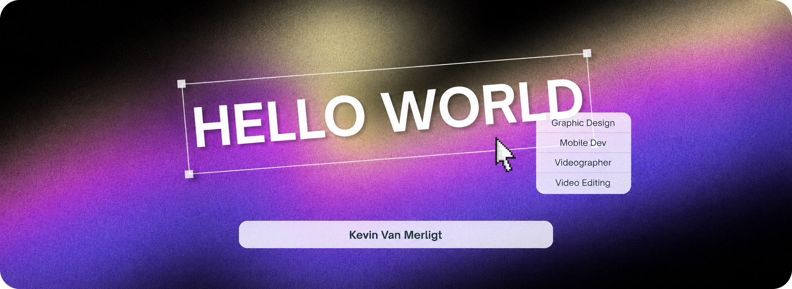

<!-- 1. CUSTOM BANNER & TYPING SVG -->

  
    

<!-- 2. ABOUT ME -->
## 👋 About Me

- 🙌 Hi there! I'm **Kevin Van Merligt**, someone who enjoys learning about technology and programming.
- 🌱 Currently learning and exploring **Web & Mobile App Development** step by step.
- 💻 Still a beginner and far from a pro, just trying to get a little better every day!
- 🤝 Always open to making new friends, learning together, and sharing ideas.
- 📫 Feel free to reach out to me at **contactvozzio@gmail.com**
- 🎧 Fun fact: *I love coding while listening to my favorite tracks on Spotify.*

 

---

<!-- 3. SOCIAL MEDIA -->
## 🌐 Connect With Me

  
  
  
  
  

---

<!-- 4. LANGUAGE & TOOLS (Tampilan Panjang + Nama) -->
## 🛠️ Languages and Tools

  
  
  
  
  
  
  
  
  
  
  
  
  
  

---

<!-- 5. GITHUB TROPHY -->
## 🏆 GitHub Trophies

  

---

<!-- 6. GITHUB STATS (Minimalis & Ringkas) -->
## 📊 GitHub Stats

  
  

 

  

---

<!-- 7. SPOTIFY NOW PLAYING -->
## 🎧 Currently Vibing To (Spotify)

  

---

<!-- 8. MOTIVASI / RANDOM DEV QUOTE -->
## 💡 Daily Motivation

  

---

<!-- 9. ANIMASI ULAR GERAK -->
## 🐍 Contributions Repo

  <picture>
    <source media="(prefers-color-scheme: dark)" srcset="https://raw.githubusercontent.com/kevinvanmerligt/kevinvanmerligt/output/github-contribution-grid-snake-dark.svg">
    <source media="(prefers-color-scheme: light)" srcset="https://raw.githubusercontent.com/kevinvanmerligt/kevinvanmerligt/output/github-contribution-grid-snake.svg">
    
  </picture>

<!-- Footer Wave -->

